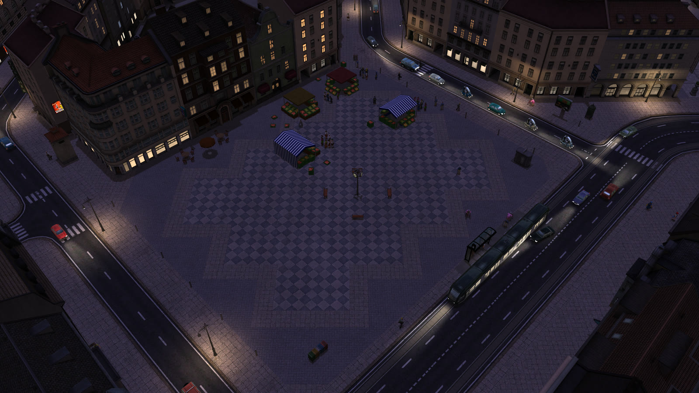
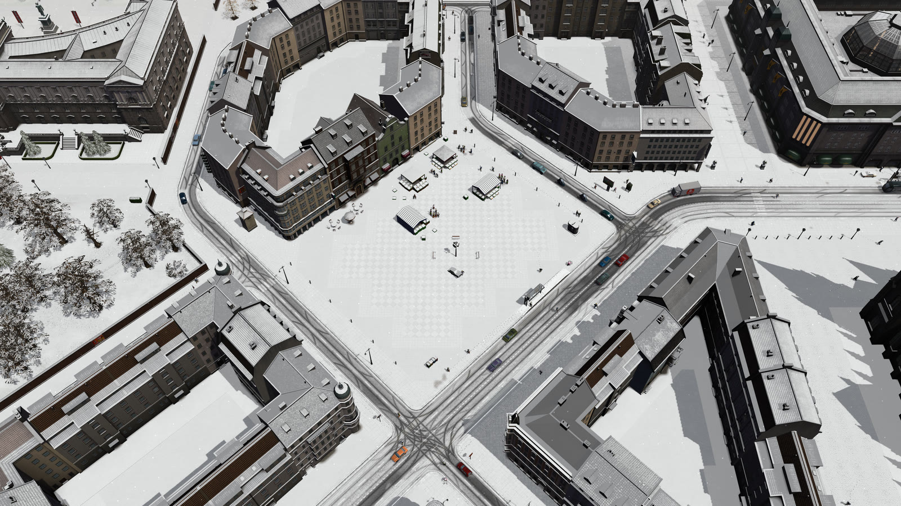
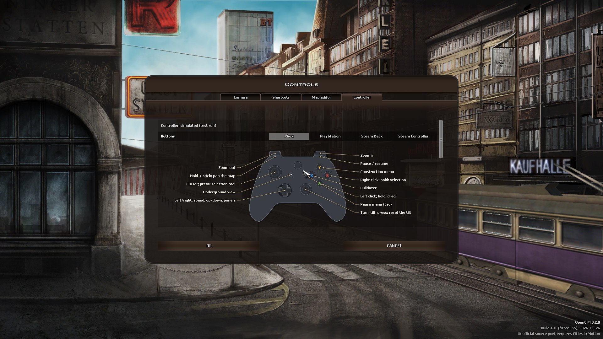
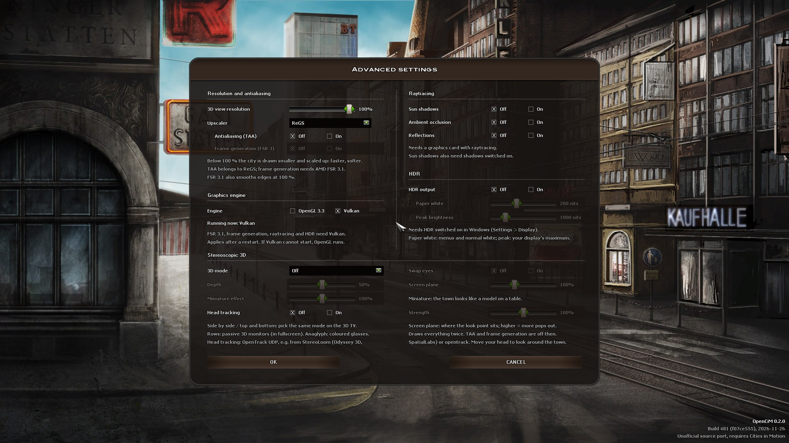
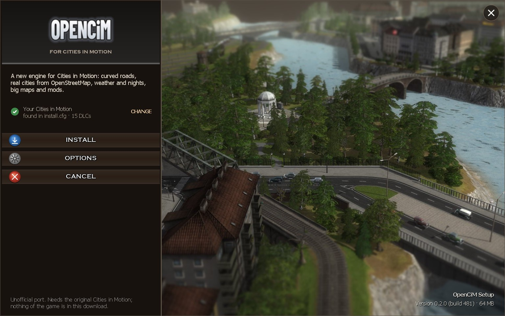
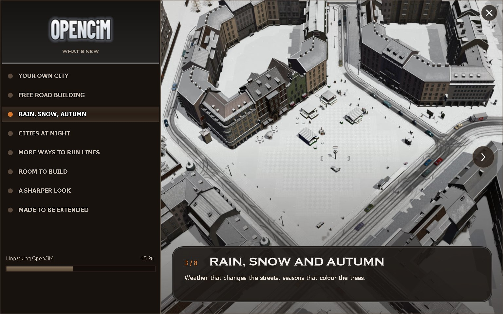

# OpenCiM

**An unofficial source port of Cities in Motion (2011).** OpenCiM reimplements the game's engine, `GSystem.dll`, in
portable C++20 and runs the game's own scripts and data from your installed copy. It loads your original saves and
adds what the old engine never could: a Vulkan renderer with raytracing, HDR and FSR, stereoscopic 3D, curved roads,
weather and seasons, nights with real lights, controller support, big maps and mods.

> You need your own copy of **Cities in Motion** (Steam, GOG or retail). Nothing from the game is part of this
> repository, and OpenCiM never changes the files of your install.

**[Download the latest release](https://github.com/Pfahli/OpenCiM/releases/latest)** (Windows, 64-bit)


*Evening on the market square: windows light up, street lamps come on, and the tram's headlights glow at its stop.*

## Features

### Maps and building
- **Your own city:** build a map of any real town from OpenStreetMap, with its streets, railways, rivers, parks and
  buildings. Palaces, castles, churches, glass office towers and shops with striped awnings are built for it on the fly.
- **Free road building:** curved roads of every kind, junctions at any angle, avenues, tunnels, bridges and express
  ramps.
- **One-way streets**, also with one-way tram tracks.
- **Roundabouts** with one or two lanes, with trams running through them.
- **Tracks:** curved tram tracks, 45° tram switches, level crossings with railways and tram tracks, and trams running on
  railway tracks.
- **Working traffic lights** at the junction corners, facing the oncoming traffic, with green waves.
- **Streets by the water** keep their height, with quay walls, railings and iron fences.
- **Room to build:** maps from 128 up to 2048 cells, existing maps enlarged, map templates (`.cimtpl`), round paint
  brushes with exact edges, and new editor tools.
- **Your saves still work:** saves from the original game load in OpenCiM, and the campaign and the tutorial play
  through from start to finish.

### Lines and vehicles
- **Destination displays show the real line:** the line number and its name or end stop appear on trams, buses and
  metros, front and side, in LED or printed fonts. Long names scroll as a ticker.
- **People in the vehicles:** drivers and passengers sit in the windows, lit after dark. Articulated trams light every
  section, and double-deckers seat passengers upstairs.
- **More ways to run lines:** trams on railway tracks, tram stops at train stations, metro trains that turn at end
  stations, and bus lines that can use tram stops in the street.
- **Vehicle shop** with the whole train in the preview.
- **Boat wakes** behind boats and water buses.

### Weather and seasons
- **Rain:** wet streets with puddles that dry afterwards, fine streaks around the camera, spray behind vehicles, and
  thunderstorms.
- **Snow:** roofs, squares and streets turn white, cars leave tracks, and snowploughs clear the roads.
- **Seasons:** the trees turn green, autumn-coloured and bare through the year, and the temperature follows the month.
- **Slower traffic** in snow and heavy rain (optional).
- It all ships as the built-in weather mod, and every part can be switched off.

### Day and night
- **The time of day runs with the game**, with dusk, a moonlit night and dawn. The day length is adjustable, and you can
  switch back to the original's fixed time of day.
- **Night lights:** lit windows, street lamps that light the ground, lit signs and advertisements, market stands and
  clocks.
- **Vehicles at night:** headlights, lit cabins with passengers, and glowing destination displays.

### Graphics
- **Vulkan renderer** (OpenGL as a fallback) with raytraced shadows, reflections and ambient occlusion on graphics
  cards that support it.
- **AMD FSR 3.1** upscaling and frame generation, **HDR10** output, TAA and the port's own upscalers.
- **Stereoscopic 3D:** side by side, top and bottom, row-interleaved for passive 3D monitors, and anaglyph for coloured
  glasses. Depth, screen plane and a miniature effect are adjustable, and head tracking over OpenTrack (for example
  from SpatialLabs or opentrack) lets you look around the town by moving your head.
- **A sharper look:** better shadows, lens blur and tilt-shift, colour styles, and a 200 % view distance.
- **Sharper textures:** the game's textures upscaled 2× on your PC from your own install.
- **Fast:** on a large save with 87,000 objects, OpenCiM runs at over 200 fps with Vulkan on an RTX 3080. The original
  holds the screen's 60 Hz there.

### Controls and interface
- **Controller support:** Xbox and PlayStation pads, Steam Deck and Steam Controller, with button prompts for each
  layout. Mouse and keyboard keep working alongside.
- **Smooth camera** that can snap to the eight main directions; hold Shift to turn freely.
- **UI scaling** (1×, 1.5×, 2×) for high-resolution screens.
- **Pop-out views:** press F7 to open more views of your city, each in its own window with its own camera, on any
  monitor.

### Sound and mods
- **New audio engine** in place of FMOD, with the original's speaker modes, a new binaural Headphones mode, and
  separate volumes for effects, ambience and interface.
- **Mods:** a mod manager loads new content beside the game without touching its files. Two mods are built in:
  weather and seasons, and *Cheats in Motion* behind a magic wand in the left bar.

### Quality of life
- **Catchment view:** while you place a stop, every building within its reach turns green, as on the minimap, and
  stays green after you place it.
- **Fair stop upgrades:** upgrading a stop costs the new price minus the old stop's refund, and the stop keeps its name
  and lines.
- **Jam relief:** a bus or tram stuck for two minutes no longer blocks the street for good. The cars around it turn
  back, and if it is still stuck, it skips ahead and its passengers plan again.
- **Autosave.**
- **Settings apply at once:** fullscreen, resolution, bloom and the other graphics options need no restart.
- **The menu music can follow the music volume** instead of always playing at full volume.
- **Sandbox densities:** traffic and population at 0.5×, 1×, 2× or 4×.
- **Your own folder:** saves, maps, settings and mods live in `Documents\OpenCiM`. Saves and maps from the original game
  are listed there and copied in when you open them.
- **Finds the game by itself** (Steam, GOG or retail), and can download your own copy through SteamCMD without the
  Steam client.
- **Crash reports stay on your PC:** a report and minidump go to `Documents\OpenCiM\crashes\`, and nothing is sent.

### Multiplayer (in development)
Multiplayer is being built and is not in the releases yet:
- **Coop:** several players run one transport company together.
- **Competitive:** up to 4 players, each with their own company. The host picks the goal: the highest net worth after
  60 minutes, the first to a set net worth, or the first to a set number of passengers.
- **Hosted by a player or on a dedicated server**, with a server list, a relay for players behind firewalls, chat, and
  vehicles in each player's colour.
- **Cross-platform lockstep:** every PC runs the same simulation tick by tick, with math that gives identical results
  on every platform.

## Screenshots

| | |
|---|---|
|  |  |
| *A suburb with tilt-shift and soft shadows.* | *Winter in the old town: snow settles on roofs and squares, and cars leave tracks in the streets.* |
|  |  |
| *A low-floor tram at its stop on a tree-lined avenue.* | *Tilt-shift, soft shadows and colour grading turn the market square into a model town.* |
|  |  |
| *Every button explained, with layouts for Xbox, PlayStation, Steam Deck and Steam Controller.* | *Upscaling and frame generation, Vulkan or OpenGL, raytracing, HDR and stereoscopic 3D.* |

### The setup program

| | |
|---|---|
|  |  |
| *The setup finds your game and its DLCs, and installs without admin rights.* | *While it unpacks, it shows what's new. Later it updates, repairs or uninstalls OpenCiM.* |

## Getting started

### Windows
Download `OpenCiM-<version>-setup.exe` from the [latest release](https://github.com/Pfahli/OpenCiM/releases/latest)
and run it. It finds your Cities in Motion install, or downloads your own copy through Valve's SteamCMD; the account
must own the game. You can also unpack `OpenCiM-<version>-win64.zip` anywhere and start `regs.exe`.

OpenCiM keeps all player data in `Documents\OpenCiM`, apart from the original game's folder.

### Linux
There is no native Linux build yet. OpenCiM's window, input and controller code is Windows-only for now, and a native
build is planned. Until then, you can try the Windows build through Proton or Wine with Vulkan; this is not tested yet.

### Build from source (Windows)
You need the Visual Studio 2022 Build Tools with the C++ workload. MSVC, CMake and Ninja are taken from there, and
every other dependency is bundled in `port/third_party`. Some files there (AMD FSR) have long paths, so enable long
paths in Git before you clone:

```powershell
git config --global core.longpaths true
git clone https://github.com/Pfahli/OpenCiM.git
cd OpenCiM\port
.\build.ps1                 # Release x64 into build\x64-Release
.\build.ps1 -Config Debug   # or RelWithDebInfo; -Arch x86; -Clean
.\build\x64-Release\regs.exe "C:\Program Files (x86)\Steam\steamapps\common\Cities In Motion"
```

Without a folder argument, OpenCiM looks for the game itself.

## Repository layout

| Folder | Contents |
|---|---|
| [`port/`](port/README.md) | The engine, the setup program, tools, the port's own scripts and shaders, and the built-in mods. [`port/README.md`](port/README.md) covers the build, settings, test flags and status in detail. |
| [`docs/`](docs/REPORT.md) | The engine specifications the port follows: file formats, script runtime, renderer, simulation and UI. |
| `tools/` | Analysis and helper scripts. |
| `screenshots/` | Pictures for this page. |

## Status and roadmap

OpenCiM is in active development. Original saves load and run with full traffic and citizens. You can lay track,
place stops, create lines, buy vehicles, carry passengers, and save and reload. The remaining work to a fully playable
game is in [`port/docs/playable-todo.md`](port/docs/playable-todo.md). After that come multiplayer, a native Linux
build, ARM64, high-res textures and more quality-of-life features ([`port/docs/ideas.md`](port/docs/ideas.md)).

## License

OpenCiM is free software under the **GNU General Public License v3.0 or later** ([`LICENSE`](LICENSE)). The license
covers the port's own code, tools, shaders, scripts and documentation. Bundled third-party code keeps its own license
(MIT, BSD, Apache-2.0, public domain or CC0); see [`port/README.md`](port/README.md#license).

*Cities in Motion* is a trademark of its owners. OpenCiM is a fan project, not affiliated with or endorsed by Colossal
Order or Paradox Interactive. The game and its data belong to their owners and are not included here.
