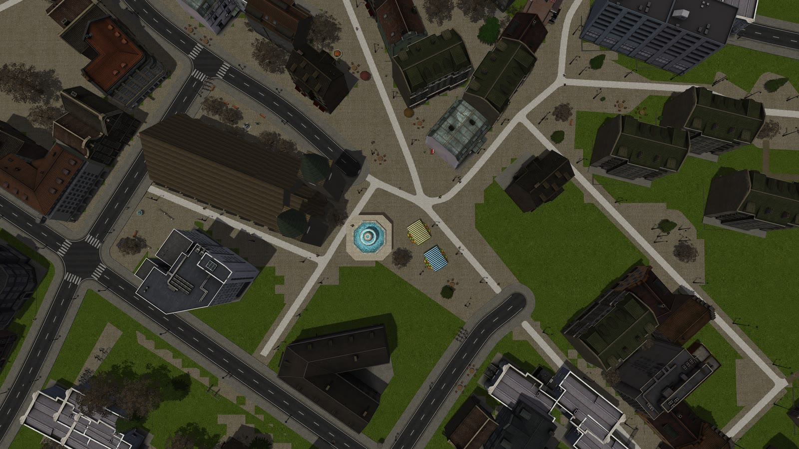
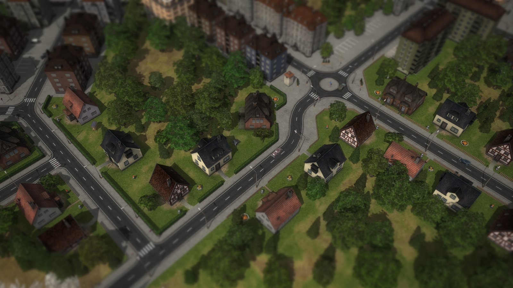
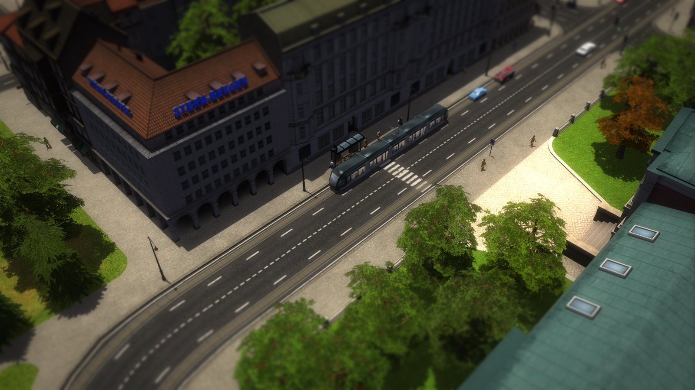
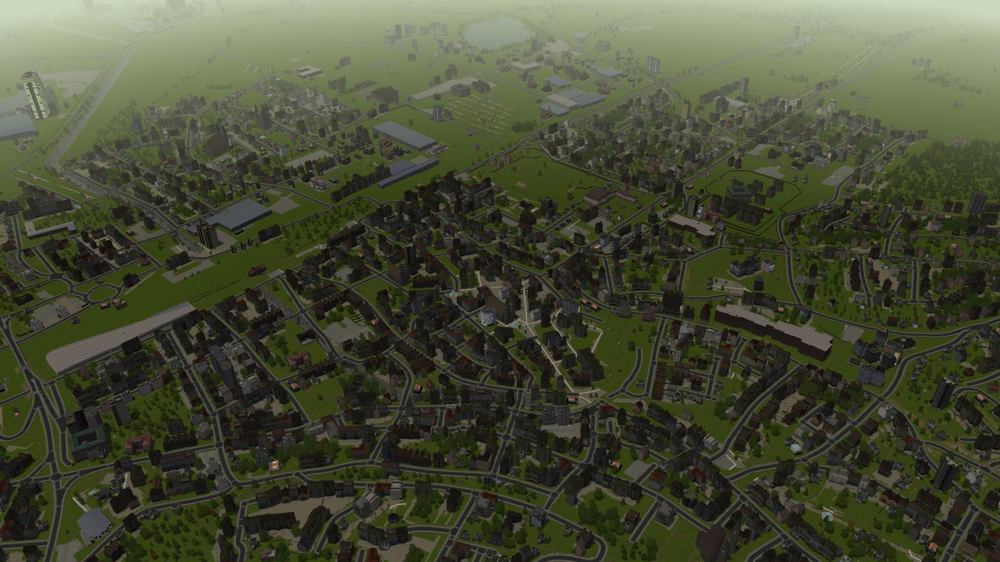
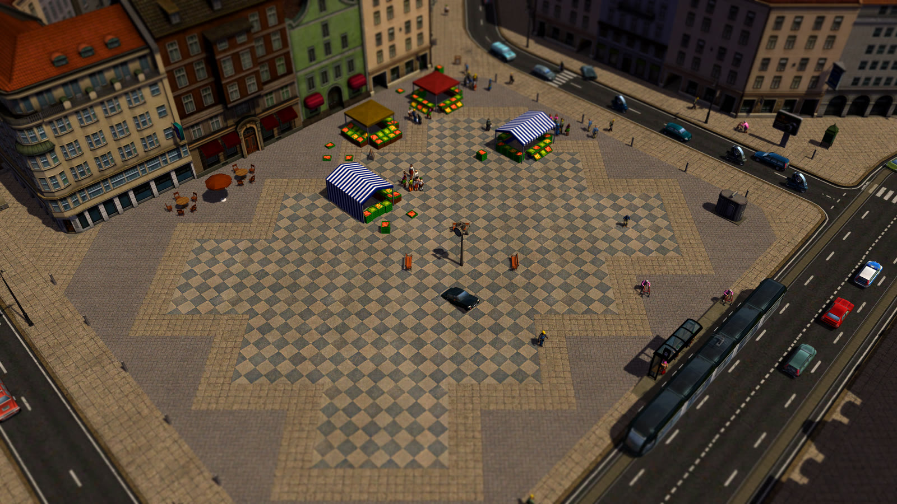
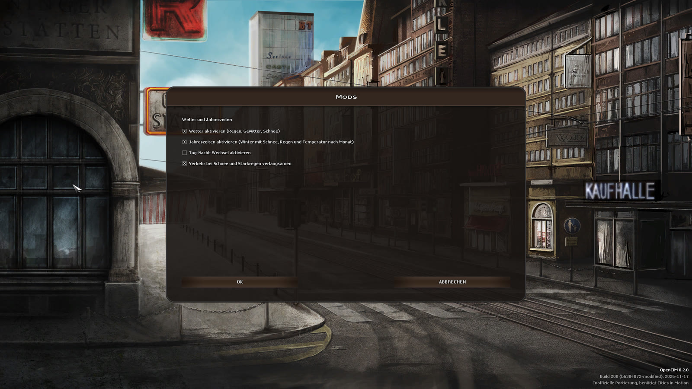

# OpenCiM

**An unofficial source port of Cities in Motion (2011).** OpenCiM reimplements the game's engine, `GSystem.dll`, in
portable C++20 and runs the game's own scripts and data from your installed copy. It loads your original saves and
adds what the old engine never could: a Vulkan renderer with raytracing, HDR and FSR, curved roads, weather and
seasons, night lights, controller support, big maps and a mod system.

> You need your own copy of **Cities in Motion** (Steam, GOG or retail). Nothing from the game is part of this
> repository, and OpenCiM never changes the files of your install.



## Features

### Building and playing
- **Your own city:** build a map of any real town from OpenStreetMap, with streets, rail, rivers, parks and buildings.
- **Free road building:** curves, roundabouts, one-way streets, avenues, tunnels, bridges and express ramps.
- **More ways to run lines:** trams on railway tracks, tram stops at stations, and metro trains that turn at end stations.
- **Room to build:** maps up to 2048 cells, map templates (`.cimtpl`), new building tools and autosave.
- **Catchment view:** while you place a stop, the buildings within its reach light up green, as on the minimap.
- **Your saves still work:** saves from the original game load in OpenCiM.
- **Controller support:** Xbox and PlayStation pads, Steam Deck and Steam Controller, with button prompts for each layout.
- **Pop-out views:** press F7 to open more views of your city, each in its own window with its own camera, on any
  monitor.

### Graphics
- **Vulkan renderer** (OpenGL as a fallback) with raytraced shadows, reflections and ambient occlusion on GPUs
  that support ray queries.
- **AMD FSR 3.1** upscaling and frame generation, **HDR10** output, TAA and the port's own upscalers.
- **A sharper look:** better shadows, lens blur and tilt-shift, colour styles, and UI scaling for big screens.
- **Sharper textures:** the game's textures upscaled 2× on your PC from your own install.
- **Cities at night:** street lamps, lit windows, headlights and lit trams after dark.

### Weather, sound and mods
- **Rain, snow and autumn:** weather that changes the streets (wet roads, puddles, spray, snow) and seasons that colour
  the trees. It ships as the built-in weather mod.
- **New audio engine** in place of FMOD, with the original's speaker modes and a new binaural Headphones mode.
- **Made to be extended:** a mod manager that loads new content beside the game without touching its files.
- **Crash reports** that stay on your PC: a report and minidump go to `Documents\OpenCiM\crashes\`, and nothing is sent.

## Screenshots

| | |
|---|---|
|  |  |
| *Free road building* | *Rain, snow and autumn* |
|  |  |
| *Cities at night* | *More ways to run lines* |
|  |  |
| *Room to build* | *A sharper look* |


*The mod manager*

## Getting started

### Install
Run the setup program from a release (`OpenCiM-<version>-setup.exe`). It finds your Cities in Motion install (Steam,
GOG or retail). Without the Steam client, it can download your own copy of the game through Valve's SteamCMD; the
account must own the game.

### Build from source (Windows)
You need the Visual Studio 2022 Build Tools with the C++ workload. MSVC, CMake and Ninja are taken from there, and
every other dependency is bundled in `port/third_party`.

```powershell
cd port
.\build.ps1                 # Release x64 into build\x64-Release
.\build.ps1 -Config Debug   # or RelWithDebInfo; -Arch x86; -Clean
```

### Run
```powershell
.\build\x64-Release\regs.exe "C:\Program Files (x86)\Steam\steamapps\common\Cities In Motion"
```

Without a folder argument, OpenCiM looks for the game itself. It keeps all player data in `Documents\OpenCiM`
(settings, saves, maps, mods), apart from the original game's folder. When you open saves and maps from the original
game, OpenCiM copies them into its own folder.

## Repository layout

| Folder | Contents |
|---|---|
| [`port/`](port/README.md) | The engine, the setup program, tools, the port's own scripts and shaders, and the built-in mods. [`port/README.md`](port/README.md) covers the build, settings, test flags and status in detail. |
| [`docs/`](docs/REPORT.md) | The engine specifications the port follows: file formats, script runtime, renderer, simulation and UI. |
| `tools/` | Analysis and helper scripts. |

## Status and roadmap

OpenCiM is in active development. Original saves load and run with full traffic and citizens. You can lay track,
place stops, create lines, buy vehicles, carry passengers, and save and reload. The remaining work to a fully playable
game is in
[`port/docs/playable-todo.md`](port/docs/playable-todo.md). After that come high-res textures, native ARM64 builds,
more quality-of-life features and multiplayer ([`port/docs/ideas.md`](port/docs/ideas.md)).

## License

OpenCiM is free software under the **GNU General Public License v3.0 or later** ([`LICENSE`](LICENSE)). The license
covers the port's own code, tools, shaders, scripts and documentation. Bundled third-party code keeps its own license
(MIT, BSD, Apache-2.0, public domain or CC0); see [`port/README.md`](port/README.md#license).

*Cities in Motion* is a trademark of its owners. OpenCiM is a fan project, not affiliated with or endorsed by Colossal
Order or Paradox Interactive. The game and its data belong to their owners and are not included here.
